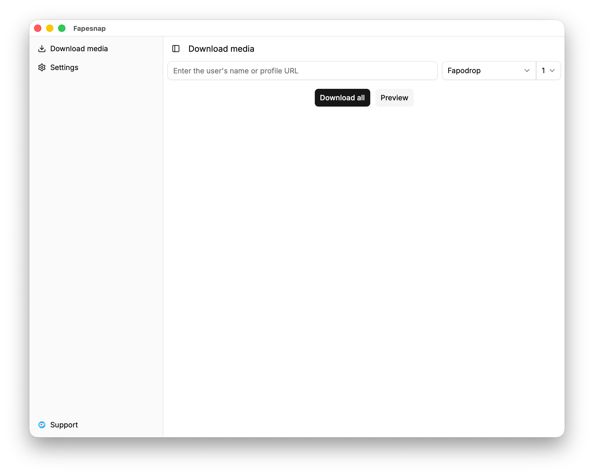
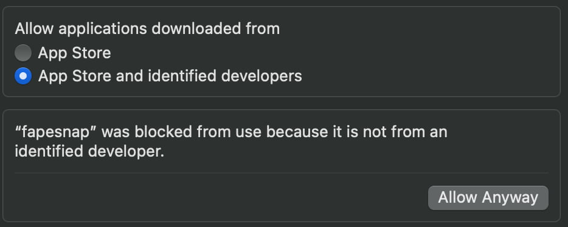

# Fapesnap - Nudes (most often) downloader

An app for downloading nudes from various sites.

Provider list

- Fapello
- Fapodrop
- Bunkr

## Usage

Open the app, paste a link to the user's profile or their username (for Fapodrop and Fapello) or a link to an album or album ID (for Bunkr), select the appropriate provider, and choose "Download" if you want to download the files immediately, or "Preview" to preview them.



## Development

Requirements: Go 1.27.3 or later and Bun.

```sh
bun install
bun run dev
```

Generate the typed Go bindings after changing Go service methods or events:

```sh
bun run generate
```

Check and package the app with:

```sh
bun run check
bun run build
```

## Automatic updates

MyGo's signed auto-updates require the public key in `mygo.config.ts` to match
the private signing key used during the build. Generate a key pair with
`bunx mygo-cli keygen`. Keep `mygo-update.key` private and provide its contents
as the `MYGO_UPDATER_PRIVATE_KEY` GitHub Actions secret. Releases and
auto-updates are published from the `nakrovati/fapesnap-mygo` repository.
Builds still upload installers when the signing key is not configured, but
those builds will not self-update.

## Installation

All releases are in the "releases" section at this link - <https://github.com/nakrovati/fapesnap-mygo/releases>.

### Windows

Download and run the matching Windows installer from the releases page.

### Linux

Download and install the matching Debian package, or use the Linux archive
and its included `install.sh`.

### MacOS

Download the disk image for your processor architecture. If macOS prevents
the app from opening, you may need to allow it in system settings.

> [!WARNING]
> Allowing execution of macOS programs from unreliable sources is potentially dangerous. If you are afraid to allow execution of this program, download it on Windows or Linux.

1. Open the system settings
   

2. Go to privacy settings
   

3. Allow the program to run
   
